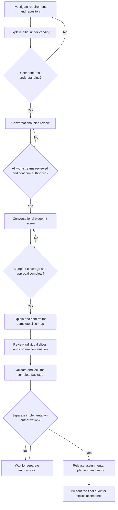

# Enforced conversational workflow

New blueprint initiatives and existing blueprint initiatives with plan review and requirement traceability use the conversation controller. The coordinator derives progress from the versioned review records, coverage reports, and consent receipts in the initiative directory. Existing initiatives retain their recorded approval contracts. After an interruption, run `resume --format json` and `validate`. Use `plan_review`, `workflow_progress`, and `slice_review` for the current position, and use the saved question and linked reply to resume the discussion.

| Before proceeding | Evidence the coordinator checks |
| --- | --- |
| Freeze discovery and plan | Confirmed intake, repository evidence, requirement mapping, and the current audit and roadmap |
| Draft the blueprint | Every plan workstream reviewed in order, complete requirement mapping, and the recorded instruction `Continue to blueprint` |
| Request blueprint approval | Current blueprint, passing coverage, each workstream's presentation and explicit continuation, no open consequential questions, and the displayed consistency report and recap |
| Plan slices | A separately recorded approval of the exact blueprint |
| Review a slice | The complete slice map has been displayed and confirmed |
| Move to the next slice | Current revision reviewed or explicitly delegated, open choices resolved, and the user's explicit continuation |
| Lock the package | Reviews match every selected revision, cross-slice validation passes, and the user approves the package |
| Release work | Separate start authorization for the locked package and accepted dependencies for the assignment |
| Record final acceptance | Current passing final audit, resolved or explicitly deferred feedback, and explicit acceptance of that audit |

## Request approval of a blueprint

Use [Natural replies and authorization](user-confirmation.md) for protocol-enabled initiatives. The preview provides a scoped question. Earlier controller initiatives use the exact-version reply described below.

1. Prepare the [approval draft](../assets/project/blueprint-approval.template.json) with the current version, exact displayed paths, consistency report, decision recap, and exceptions. Include the review viewer checkpoint when applicable. Omit `approved_by_user`, `user_approval_note`, and `approval_exchange_id`.
2. Run `blueprint-approval-preview --approval-file <draft.json>`. If it blocks, resume at the named workstream or open question. When it passes, present the current blueprint, coverage, and recap. Ask the preview question for protocol-enabled initiatives. For earlier initiatives, ask for the exact instruction printed by the command, such as `Approve blueprint spec-v3`.
3. Save the actual presentation and exact question in Markdown. Record a `conversation-record` checkpoint with `phase: blueprint`, `record_type: review_checkpoint`, `review_step: blueprint_approval`, `status: open`, the blueprint ID as `review_version`, a visible `review_target`, the presentation in `evidence_paths`, and the preview's `approval_presentation` object. Include the affected scope.
4. After the user replies, record a new `status: decided` checkpoint with the same identity, question, and scope and `responds_to` set to the open exchange ID. Omit `approval_presentation`. Use `review_action: confirm` for the exact approval instruction or `revise` for a change request. Use `revisit` and set `revisit_workstream` to the exact completed workstream when the user says `Revisit <workstream name>`. The revisit needs its own walkthrough and continuation before a new approval request. Keep the checkpoint open for acknowledgments.
5. Submit `approve --approval-file <approval.json>` with the original draft fields, `approved_by_user: true`, the exact answer in `user_approval_note`, and the decided exchange ID in `approval_exchange_id`. The lock binds the displayed paths and both exchanges. If the design or reviewed evidence changes, return to the affected review and present a fresh request.

## Record final acceptance

For application completion review, show the audit ID and SHA-256. Ask whether the user accepts the current audit under the [confirmation protocol](user-confirmation.md). For earlier controller initiatives, use `Accept final audit <audit-id>`. Save the displayed question in Markdown and set `presentation_path` in the `visual-quality --action accept` input. Use the exact user reply.

The coordinator checks the saved excerpts, linked decisions, and artifact hashes. The same assistant records the terminal exchanges, so the coordinator cannot independently authenticate chat messages or verify the user's understanding. Its gates apply to commands routed through the coordinator.
