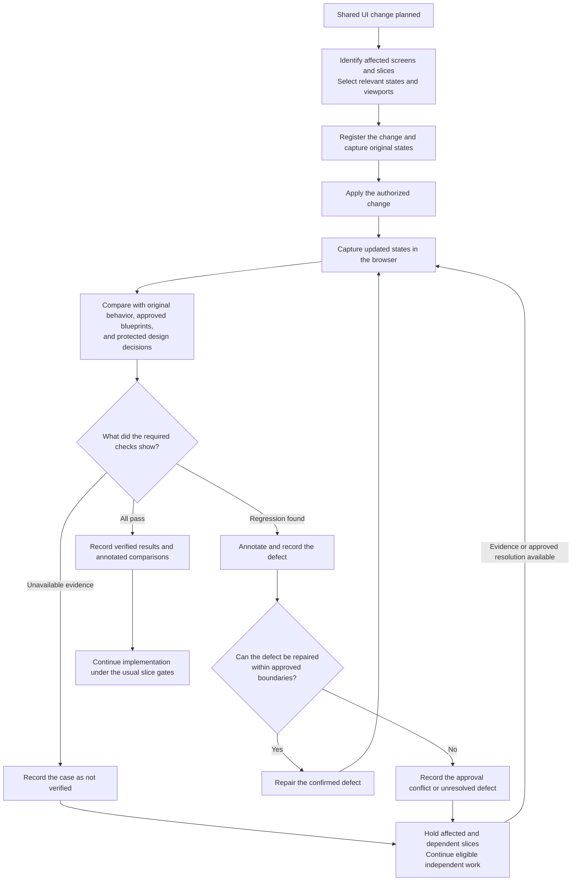

# Cross-Screen Visual Regression Protection

Start this workflow before editing any shared UI component. It applies to routine implementation, redesign, refactoring and defect repair. Include shared themes, styles, design tokens, layouts and interaction helpers when changing them can affect multiple screens. Run it within the authorized implementation assignment and apply the slice's [Visual Integrity Gate](visual-integrity.md) before acceptance.

## Implementation flow



## Find the affected screens

1. Inventory the source files the change will touch. Trace direct and transitive consumers through imports, re-exports, wrappers, route layouts, feature flags, configuration, theme providers and shared state. Check route definitions and the running application for consumers that source search alone might miss. Use the locked blueprint, slice guides, approval history and any earlier cross-screen change groups to map consumers to slices. Include existing routes without an assigned slice.
2. Record each affected route, the slices that use it and the evidence that connects it to the changed files. Name the consumer files that the comparison depends on. A route reached through a shared layout can have several owning or consuming slices. Check the route in its local context, including nearby controls and other content that could overlap or lose focus.
3. Use adaptive coverage to select the states and viewports at risk. For a menu sizing change, check open and closed states where they exercise different layout, the narrow widths where surrounding controls could collide, and keyboard navigation, dismissal and focus return. Reuse applicable approved render cases and supplement them where the shared impact extends further. For approved cases on the same route that exercise a different feature, record the reason they are unaffected. Avoid duplicate state and viewport combinations that exercise the same behavior.
4. Put a real browser assertion on every case. Include pointer and keyboard setup where the expected behavior depends on those inputs. For a static shared element, assert a relevant semantic or visible outcome. Record which approved requirement or existing behavior each case should preserve. If a route, fixture, state or viewport is unavailable, keep the case in the plan and give its verification result and reason.

Classify changed paths for every implementation pass. Include the resulting shared source files in the worker report's `shared_ui_paths` array as well as `implementation_paths`. Use an empty array after checking a slice whose change is local. Existing code can use any UI framework. Codex traces usage from the project's actual source and routing conventions, and the coordinator checks the declared plan, the browser evidence and later changes to registered shared source bytes.

## Plan and capture the original application

Register a change before modifying the shared files. Begin with the [plan template](../assets/project/cross-screen-plan.template.json). Use the originating released slice as `--slice-id`. `component_paths` are exact project-relative files inside that slice's write scope. Group files that change together under one change ID. Name every affected route in `screens` with a reason, `slice_ids` and consumer `source_paths`. For consumers with indirect or generated bindings, use `source_note` if a concrete consumer file is unavailable.

In blueprint mode an exact case uses `feature_id/case_id` in `approved_case`. In prototype mode use the approved case ID. The browser uses the locked route, viewport, setup, assertions and measurements where defined. For an adaptive case, specify the expected behavior and why the state was selected. Use the route's `unaffected_approved_cases` object to map any excluded approved ID to its dependency-based reason. Preserve the approved checks and protected decisions for all selected approved cases.

Run the commands from the skill directory with the same project root and initiative used for implementation.

```sh
python3 scripts/project_state.py cross-screen --project-root <app> --initiative-id <initiative> --slice-id <slice> --action plan --input-file <plan.json>
python3 scripts/project_state.py cross-screen --project-root <app> --initiative-id <initiative> --slice-id <slice> --action capture --input-file <capture.json>
```

A capture request names one case. Start the existing application from the original source, use the original fixtures, and capture each planned case with `phase` set to `before`.

```json
{
  "change_id": "dropdown-layout",
  "case_id": "settings-keyboard-narrow",
  "phase": "before",
  "appUrl": "http://127.0.0.1:3000",
  "browser": "google-chrome"
}
```

On resume, use `cross-screen --action list` to find the open change and completed captures. A hold for that change allows its originating worker to finish the authorized edit, capture and repair. Verification and downstream dispatch wait for the recorded result.

The coordinator saves the first original screenshots and measured browser evidence. It rejects a `before` capture if the planned original source files changed. The browser verifies the served source bytes or the build-time `X-P2P-Build-Fingerprint` of the running application. Use the same recipe and browser environment across captures, including viewport, state setup, theme, fixture, visible component, input sequence and assertions. Exercise separate cases for different roles, breakpoints or outcomes. The captured effects of the actions, such as changed focus or a missing menu, remain visible in the browser evidence.

If a baseline was missed, restore the exact original scoped source in a safe local environment and capture it before reapplying the patch. Until then record the case as incomplete. Where a workflow needs a new case after changes started, preserve the original group and evidence and extend its coverage after restoring the original scoped source. Pass the expanded plan with the same change ID to `--action extend`. Existing case definitions and original captures are retained. Preserve unresolved defect or approval-conflict evidence before using an amendment. Abandon a plan only after restoring its original source files, with an explanation in the `abandon` input.

## Inspect, repair and recheck

1. Apply the authorized change. Capture the same cases with `phase` set to `after`. Use the returned `capture_id` in the [inspection template](../assets/project/cross-screen-attempt.template.json). A supplementary repair attempt needs fresh captures of every selected case.
2. Review the full rendered page and close-up alongside the locked blueprint and original behavior. Confirm expected geometry, style, focus, selection, dismissal and responsiveness wherever relevant. The coordinator preserves both originals and marks changed image regions on copies. Visual differences are evidence for comparison. Classify them against the approved intent before treating them as defects.
3. Record a `visual`, `interaction` and `blueprint` result with a note for each planned case. List the `protected_decision_ids` checked for that case. A passing interaction result requires every captured assertion to pass. A passing blueprint result requires the approved measurements and protected decisions to be checked. If the page fails to render, omit its `capture_id`, use `not_checked` for each check and explain what prevented inspection in `unavailable_reason`. A case without its original image remains incomplete even when the updated screen renders.
4. Record failed cases as findings with stable IDs, severity, evidence and classification. Repair confirmed regressions within authorized ownership and the approved design. When another authorized slice owns the repair file, coordinate the correction through that slice and keep the recheck under the originating change. Use the existing [classification and retry rules](visual-integrity.md#classify-against-approved-intent). Record an approval conflict when a repair would change a protected decision, and seek an explicit amendment. Reuse the change ID, first captures and finding IDs for repair attempts. Mark a finding `fixed` only when its case passes all checks with fresh evidence. Include what changed and what the browser recheck demonstrated. Keep design concerns and approved differences as `noted` for deferred review.
5. Keep independent slices moving. A pending, unresolved or stale group holds the originating slice, affected slices and their transitive dependents. The targeted hold preserves their existing delivery records. A verified group removes its hold, and each slice still follows its own approval, dependency and independent verification gates. Changes to the shared files or declared consumer files make the current evidence stale. Start the next shared change from the last verified shared source with a new change ID. When only consumer files change, capture fresh `after` evidence for the existing group and record the recheck under the same change ID. The original captures and earlier attempts stay in the group.

```sh
python3 scripts/project_state.py cross-screen --project-root <app> --initiative-id <initiative> --slice-id <slice> --action record --input-file <attempt.json>
python3 scripts/project_state.py cross-screen --project-root <app> --initiative-id <initiative> --action list
python3 scripts/project_state.py review-viewer --project-root <app> --initiative-id <initiative>
```

Open **Visual Review Register** in the Living Blueprint and Slice Review viewer. Search by change ID, route, slice or finding, and expand a case to inspect its comparisons, assertions, measurements and repair history. Include change IDs, outstanding findings, coverage limitations and the viewer command at handoff.
