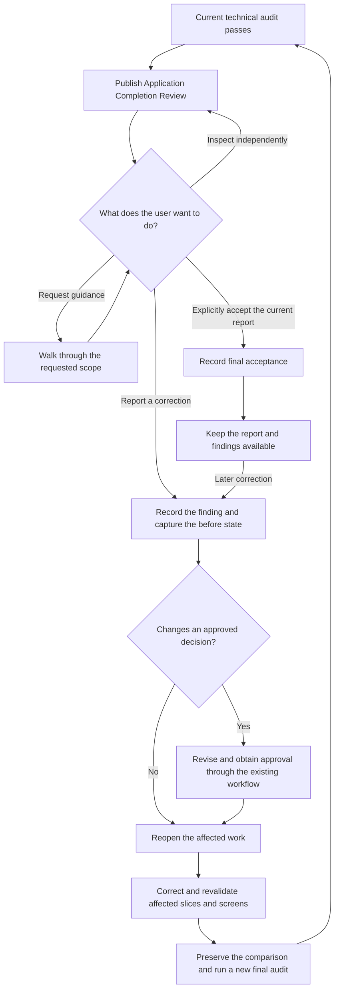

# Application Completion Review

When the final audit passes, open **Application Completion Review** in the Living Blueprint viewer. The dashboard is available automatically and can be shared with the user as the local viewer URL ending in `/#final-review`. Present the audit ID and SHA-256 with the verified slice count, repairs, warnings and any open review feedback. The user may inspect sections in any order or explicitly accept the current report immediately.

The implemented side of each comparison uses captures from the passing slice or cross-screen checks recorded by that report. Older reports without capture IDs use the saved captures for the report's approval and date.



## Guide a review on request

Ask which workstream, feature, slice collection or application scope the user wants to see if they have not already named it. For a full walkthrough, start with an overview and proceed by feature area in dependency or journey order. For a partial walkthrough, stay within the requested sections and include dependencies when they explain a result.

1. Open the relevant dashboard section with the user. Describe what the feature does in everyday terms and demonstrate an important interaction when the running application is available.
2. Show what existed, what the blueprint approved and what was implemented. Point to the exact screenshot, approval or test result. Describe missing references as evidence gaps.
3. Show the important repair comparisons and remaining warnings. Explain the observed impact and which checks passed, then let the user choose the next section or report a correction.
4. Treat the walkthrough as optional. Use the [explicit acceptance command](visual-quality.md#record-final-acceptance) only after the user accepts the exact current report. Keep earlier acceptances and warnings available in the dashboard.

## Handle a correction during or after review

Use `visual-quality --action correction --input-file <json>` with the standard project and initiative arguments. Each input appends a record under `visual-quality/correction/`. Use `visual-quality --action status` or the dashboard to resume a finding.

| Status in input | Additional fields | When to record |
| --- | --- | --- |
| `reported` | `audit_id`, `slice_ids`, `user_feedback` | Save the user's actual feedback and identify the slices responsible for the change before editing. The record links their locked assignments, blueprint references and decisions. |
| `triaged` | `finding_id`, `disposition`, `rationale`, `before_capture_ids` | Compare the feedback with locked scope and protected decisions. Explain why it fits the approval (`within_approval`) or needs a new one (`requires_amendment`). Set `before_capture_ids` to a map from each directly affected UI slice to a list of matching browser capture IDs. Use captures from the current implementation, before changes to source or approval. Use an empty map for entirely nonvisual work. |
| `in_progress` | `finding_id`, `slice_ids`, `replacements` | For an in-scope fix use the original approval and an empty replacement map. For a changed decision, record the user's decision and complete the existing blueprint or prototype approval and applicable slice package amendment and release first. Map old IDs to their approved replacement IDs when changed. The transition reopens the targeted work and holds its dependents. |
| `verified` | `finding_id`, `after_capture_ids`, `summary` | After fixing within scope, rerun affected functional, visual and shared-screen checks and reconcile the affected slices to accepted. Supply fresh capture IDs from their passing visual attempts in the same map format for directly affected UI slices. Explain the observed correction and checks. |
| `deferred` | `finding_id`, `user_response`, `rationale` | With the user’s explicit decision, leave a nonblocking concern open for deferred review while the technical report is current and passing. Triage the same finding again if the user later requests action. |
| `withdrawn` | `finding_id`, `user_response` | Record an explicit withdrawal before implementation begins. Preserve the original request and triage. |

Use `visual-integrity --action capture` for the before and after browser captures. Choose a relevant route, viewport and interaction state. Match the before and after conditions. If an approved amendment intentionally changed a capture condition, add `comparison_map` to the verified input. Key it by before capture ID, with `after_capture_id` and a `note` explaining the correspondence for each changed case. Show the focused comparison and revalidation in the dashboard. Keep related screen evidence in the [cross-screen register](cross-screen-regression.md).

If a started correction reveals that an approved decision must change, stop implementation and record a new triage with `requires_amendment` and the original capture IDs. Treat a suggestion that would change approved design as a specification amendment. Use the revised specification and released slice contract before editing. Keep unrelated work eligible. Run the final audit again after the correction and present the new report for explicit acceptance. Earlier acceptance applies to its recorded report and remains in history. Feedback and warnings retain their recorded disposition after acceptance.

```sh
python3 scripts/project_state.py visual-quality --project-root <app> --initiative-id <id> --action correction --input-file <finding-transition.json>
```
