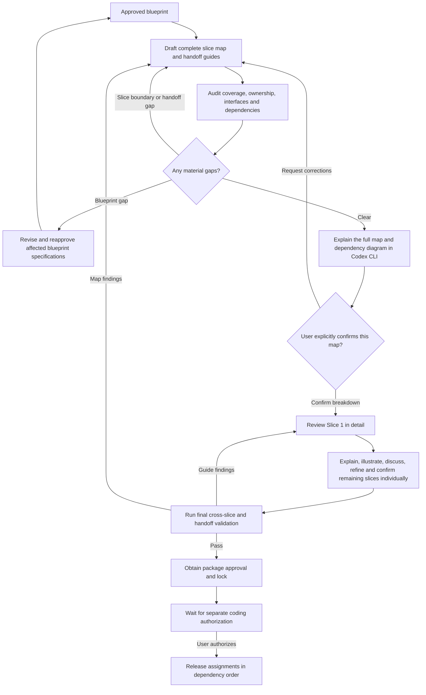
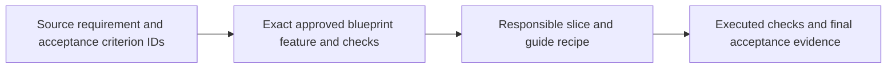

# Conversational slice review

Lead with the [terminal-first guided review](guided-design-review.md) and use the [living review viewer](living-review.md) for deeper detail and focused before-and-after comparisons.

Use this workflow after the user approves an exact blueprint in a new blueprint-first initiative. The source of truth is the recorded current user decision and amendment, then the active approved blueprint and its coverage, then the locked package, then the guide and contract, then delivery evidence. Escalate conflicts to the user and preserve the old records.

## From blueprint to implementation

## Draft the complete inventory

1. Read the approved roadmap, blueprint, baseline audit, coverage and A+ decisions. Group implementation into small vertical slices in dependency order. Assign shared files and contracts to an explicit owner and make their consumers depend on it. Cover every feature/check pair and every audited baseline behavior or requirement. Assign writable paths only within the approved footprint.
2. Copy the [proposal](../assets/project/slice-proposal.template.json) and [guide](../assets/project/implementation-guide.template.md) for each slice. Draft under a distinct subdirectory of the initiative's `inputs/`. Put Mermaid sources in `diagrams/` and worked examples in `examples/`. Link the diagrams and include fenced Mermaid. Use a state diagram for approved state transitions and a sequence diagram for an approved sequence contract. Add the approved feature documents to `artifact_paths` and link to them and the frozen A+ records from the guide's eventual directory. Fill every applicable annex from the blueprint's `surface_contracts`. Carry over reasoned inapplicability explicitly. Name the existing files a fresh agent should read first and describe planned files separately in the implementation footprint. Set `P2P_SKILL_ROOT` to the installed skill directory when running the guide's handoff commands. Put all proposal objects in a JSON object with a `slices` array and run `slice-plan` before opening a review.
3. Give each proposal a `boundary_reason` explaining why the work belongs together. The map takes each observable outcome directly from the approved checks assigned to the slice. Run `slice-plan` with the whole collection. It checks that every approved feature/check pair and audited baseline item is assigned, each acceptance check has one responsible slice, each writable path has one owner, and dependencies and shared interfaces agree. Read `slice-review/register.md` for reported gaps. Correct a decomposition problem in the proposed collection. If the approved blueprint itself leaves a behavior, interface or acceptance outcome unspecified or conflicts with a proposed change, return to blueprint review and obtain fresh approval.

Use `functional_tests` to list the approved acceptance checks assigned to a slice. Assign at least one check for each included feature. You can split a feature's checks between slices when the complete inventory still covers every approved feature and check pair. The guide's test table and delivery verification follow that slice's assignment.

For every direct dependency, add one `dependency_contracts` entry with its `dependency_id` and the kind of prerequisite.

- Use `interface` with the exact `contract_ids` declared by the provider and consumer. List any provider-owned files the slice reads in `paths`.
- Use `files` with exact provider-owned `paths` when the prerequisite supplies files without a named shared contract.
- Use `ordering_only` with a concrete `reason` and frozen `evidence_paths` when the prerequisite only sets delivery order.

Reference files the slice needs from another provider by their repository-relative paths in the architecture, requirements, integration or recipe section. A referenced provider file requires a direct `interface` or `files` dependency even when the provider is already earlier in the delivery order. Record baseline observations under **What exists now**.

All commands take `--project-root` and `--initiative-id`. Input-driven commands also take `--input-file <JSON>`. `slice-register` prints the saved question alongside the next action, slice map, slice details, package references, rejected alternatives, missing coverage and the approved source snapshot digest. `slice-guide-validate` takes `{"slice_id":"slice-example"}` and rechecks the selected guide. Install the pinned Mermaid parser in the skill directory as described in the [README](../README.md#install).

## Present and confirm the complete slice map

1. Run `slice-map` and explain the full breakdown in the terminal before opening an individual slice review. The command saves the initial terminal output for the proposed map. For each slice, explain what it delivers, why it exists, which approved requirements and checks it owns, which existing behavior it preserves, and where it changes source. Draw the dependency arrows in execution order and explain what each provider supplies. Call out overlaps or uncertainties, including ones found by reading the approved design that the CLI cannot infer. Link the generated Markdown, living viewer, and exact guide paths for detail. The viewer opens the linked guides, contracts, and current register from the map.
2. Give the user a turn to ask about scope and propose corrections. For a split, merge, ownership or dependency change, submit the complete revised collection through `slice-plan` with the actual correction and an amendment reason. Reconcile scope, coverage and dependency interfaces and present the revised map. The latest map ID and digest appear in `slice-register` and `slice-map`.
3. Ask the user to confirm the displayed map. Use the [map consent template](../assets/project/slice-map-consent.template.json) to record the exact displayed question with the map ID, path and full digest, plus the actual affirmative answer. The coordinator requires the saved terminal presentation for the exact map and binds it to the consent receipt. For example, ask for `Confirm slice-map-v1` if that is the displayed ID. If the user asks for changes or gives a conditional or unclear reply, continue the map discussion. A confirmed map opens the first pending slice. Map confirmation authorizes detailed review of the breakdown. Individual slice approval, package lock and coding each require their own decisions.
4. When a later revision changes the map, present and confirm its new version before resuming individual reviews. Refining a guide without changing the breakdown preserves map confirmation and still requires review of the new guide revision. The map Markdown keeps its original guide links. Use the register for current guide paths.

## Review one slice at a time

1. Read the current guide, contract, source anchors, test evidence and blueprint decisions. Explain in the terminal what the slice will deliver, how it matches the blueprint, which source paths it affects, what will be preserved and how to verify the result. Show a compact plain-text flow, state table, schema or layout with a concrete example. Link the exact guide revision and viewer section for detail. Save the displayed excerpt as versioned evidence before requesting slice consent.
2. Ask one consequential question at a time using grounded options and a recommendation. Record each exact exchange through `conversation-record`, including the user's verbatim response, rejected options, illustrations, source basis and affected IDs. Use phase `slice_review`. Include the current `slice_id` and `proposal_revision` when recording the question. The conversation, slice cursor and work item are written together.
3. If the proposed change alters the blueprint or approved decisions, pause and obtain a new blueprint approval. For a clarification of existing approved behavior, record the linked answer with `record_type: slice_detail`, `slice_id`, `proposal_revision` and unchanged `clarifies_decision_ids` and give the proposal a new revision through `slice-draft` when the guide or contract changes. Correct a clarification by linking its current answer with `supersedes`, keeping the same `responds_to` and scope. Update its traceability rows, preserve the original exchanges, and revalidate affected downstream slices. For an earlier slice, record `action: reopen` and the actual user reopening request.
4. Have an independent reviewer simulate the no-code handoff. Give them only the initiative evidence, blueprint and repository source. Ask them to identify the exact files, steps, states and checks and cite sections or lines for gaps. Record the reviewer, line-cited findings, no-code walkthrough and approved expected outcomes against the exact guide and contract hashes in the [review input](../assets/project/slice-review-decision.template.json). For a material blocker, use `slice-review-record` with `action: block`, the exact slice and revision, a `reason`, `evidence_paths` and the next action. Bring the uncertainty to the user. If they delegated validation, preserve that delegation in the A+ exchange while the slice is blocked.
5. Recap reconciled corrections and show the exact guide path, revision and guide/contract hashes. Attach the terminal presentation evidence to the separate [consent exchange](../assets/project/slice-consent.template.json). Record the user's affirmative consent and pass its `exchange_id` as `consent_id` when recording approval or delegation. For a selected range, list every exact slice revision and both hashes in the consent alongside the user's constraints. Use that receipt once per selected slice. Resolve consequential questions before advancing.

The independent reader saves a structured walkthrough record with the reviewer, each case, its approved outcome, exact source path and symbol, and what the reader traced. Use the exact heading text for a Markdown reference and an identifiable symbol or exact source anchor for a repository file. Attach that record to the review receipt. Include line-cited findings with `result: PASS` for **Finished experience or service contract**, **Detailed functional requirements**, and **Step-by-step implementation recipe** after comparing each with the approved behavior. Record discrepancies as blockers. Actual acceptance execution belongs in the test table. An observed test row cites an exact copy of a passing coordinator verification from an earlier authorized delivery, with current source and runner fingerprints. Record future tests as planned.

Set the attachment's `record_type` to `independent_no_code_walkthrough`. Include the same `reviewer`, `context: fresh_session`, `test_execution: false` and approved `source_paths`. Expand the receipt's `read_only_scenarios` into `cases`, one per scenario and feature/check reference. Each case keeps `scenario`, `feature_id`, `check_id`, `expected`, `observed`, `observation_basis` and `references`. Use `<feature>:<state>` for checked states, `<feature>:check:<check-id>` for acceptance checks and `<feature>:render:<case-id>` for approved render cases.

## Record explicit consent

Use `conversation-record` with `record_type: slice_consent` and `phase: slice_review`. Set `consent_action` to `confirm_map`, `approve`, `delegate`, `lock` or `start`. Capture the full displayed question and actual spoken or written answer. The displayed question includes the exact IDs, revisions and hashes in `target`. The replies below are examples. Clear alternatives such as “I approve revision 1 of slice-example” and “Please start implementation of package-v1 now” also identify the exact action and scope. Record a negative, conditional or ambiguous answer as discussion and keep the gate closed. Use a new exchange for each new approval.

| Decision | Affirmative reply | Target fields |
| --- | --- | --- |
| Confirm slice map | `Confirm slice-map-v1` | `map_id`, `map_path` and `map_sha256` from the current register |
| Approve one slice | `Approve slice-example revision 1` | `slices` with one object containing `slice_id`, `proposal_revision`, `guide_sha256` and `contract_sha256` |
| Delegate review | `Delegate review of slice-example revision 1` | Same slice fields plus `constraints`. For a range, list scopes in the displayed order, separated by commas. |
| Lock the reviewed collection | `Approve locking package-v1` | `package_id`, `collection_path`, `collection_sha256` and `recap_sha256` from the preview |
| Start implementation | `Start implementation of package-v1` | `package_id` and `package_hash` from the completed lock |

Use the generated register for progress. Review commands update the existing work cursor, or initialize one if needed. Use `work-update` for other substantial steps. When a user returns, read the saved question and any linked answer from `resume` before resuming work. Once the active question has an answer, a separately delegated sibling can be reviewed while the current slice retains its saved question and answer. Reopening or revising a proposal preserves previous receipts and invalidates the changed review and its affected dependents.

## Validate, lock and start

| Step | Command | Evidence and result |
| --- | --- | --- |
| Reconcile the collection | `slice-collection-validate` | Use the [collection input](../assets/project/slice-collection.template.json). Bind the current revisions and both hashes. Have an independent reviewer cite each applicable feature/check, render case, and shared interface, including the approved outcome or exact provider and consumers. Cover scoped inapplicability with evidence. Include affected items for a blocker. Compare decisions, schemas, routes, roles, errors, and test coverage across slices. Any blocker stops locking. |
| Approve and lock | `slice-package-lock` | Run `slice-package-preview`, save its canonical `recap` Markdown verbatim, and show the recap and hashes to the user. Record the explicit lock consent and use the [lock template](../assets/project/slice-package-lock.template.json). The CLI creates the package index, canonical manifest, exact recap and immutable lock receipt. |
| Authorize implementation | `implementation-authorize` | Present the exact package ID and full hash from the lock. Wait for an explicit new instruction to start it. Record separate start consent and use the [authorization template](../assets/project/implementation-authorization.template.json). |
| Release one executable assignment | `slice-release` | Pass the exact `package_id`, `package_hash` and `slice_id`. Release only when every prerequisite was released and accepted. Use `resume --slice-id <id>` and follow its current package `delivery_handoff.guide_path`; the contract's `locked_guide_path` identifies the exact authored evidence used to render it. Confirm `resume` and `validate` succeed and the exact slice appears under `dispatchable_slices` before dispatch or source changes. |

Under `shared_contract_review`, record a `boundary_conclusions` entry for each interacting slice pair, including pairs with a dependency or shared surface, route, path or interface. Use both sorted IDs in `slice_ids` and cite an actual line in a file frozen or approved for one of the two slices. Explain the comparison of shared routes, schemas, events, tokens or permissions, including evidence of independence where the designs share a surface but no interface.

For `case_conclusions`, use `case_kind: acceptance` for an acceptance check and `case_kind: render` for a render case. When both use the same feature and check ID, record them as two conclusions and include `case_kind` on each.

Use stable slice, feature, check, baseline or shared interface IDs in `affected_items` for material findings. The coordinator reopens the affected reviews and their dependents. If an affected item cannot be mapped to a slice, it reopens the whole collection. Resolve the recorded issue and obtain fresh review receipts before rerunning collection validation.

The CLI validates structure, provenance and explicit receipt fields. Semantic fidelity, accessibility outcomes, diagram meaning and guide clarity require independent review and user judgment. Source and test contents remain governed by the approved blueprint and existing delivery verification commands.

## Amend and recover

Stop affected work and its dependents when a material discovery changes the package. Under the same approved blueprint, unchanged released slices outside the affected dependency graph can continue under their original package authorization. Confirm the scope with `resume --slice-id <id>` and `validate --slice-id <id>`. An open question in the affected review stays on the review cursor. Re-release unchanged assignments against the newly authorized package to carry over the delivery status, immutable contract and evidence. The current package handoff names its newly rendered guide and review receipt; the retained contract may continue to point at the originating guide and records that provenance.

When cancelling a released assignment, the coordinator records the exact source in its allowed scope. This carries authorized changes into replacement planning. Keep those files at the recorded state until a replacement is separately authorized and released for the relevant paths.

Record evidence with `reconcile --action block` or `missing-feature` as applicable. For missing existing functionality, re-audit the affected scope through a full zero-new sweep and follow the blueprint reapproval procedure. Clarify the change with the user in A+ records. For a guide-only amendment, reopen and draft a new revision. A released assignment whose specification changes needs a new slice ID. On each replacement proposal, list its cancelled or superseded predecessors in `replaces_slice_ids`. Preserve their evidence and record cancellation when replacing an assignment under the same blueprint. Submit the revised inventory through `slice-plan` with the recorded amendment and actual user response. With a new blueprint approval, reconcile historical accepted work with the new contract and record fresh coverage before treating it as accepted. Create a new package version and obtain new lock approval and start authorization for the changed scope.

If a write is interrupted, retry the original command with the exact input. The prepared transition includes the staged artifact bytes, prior file hashes and the journal boundary. Recovery completes it once. Restore missing frozen files from the exact evidence set. Record a correction in a new revision and keep the original approved bytes. A repeated collection-validation request returns its committed report. To request a fresh validation run with the same evidence, add a new `validation_id` to the input.

Transfer the entire ignored initiative directory, application source and relative test references when moving to another workspace. Keep source and runner paths in accepted command arrays portable. Use a runtime available to the receiving environment and project-relative runner arguments. Include the manifest, journal, proposals, reviews, package, reports and attachments. Run `artifact-setup` in the receiving Git checkout if its local exclude needs configuring. Then start from the package index and run `resume` and `validate`. If a path or digest fails, request the original evidence from the sender before continuing. Capture versioned copies when a report needs checkpoint or register content. Workflow control files change as the initiative progresses.

## Legacy migration

Prior blueprint initiatives can continue to use their legacy assignments. Offer `slice-review-migrate` when they are ready to adopt these gates. Require `approved_by_user: true` and the verbatim `user_response`. Migration preserves all recorded history. For existing active assignments, reconcile their source and receipts and obtain a new blueprint approval before planning the reviewed inventory. Full-prototype initiatives continue to use runnable-B parity, screenshot and replay gates.

Existing locked packages retain their original approval policy. If an older reviewed-delivery initiative has an inventory and has yet to lock a package, run `slice-plan` with an amendment to create the map before continuing individual reviews or approving the package. Retain unchanged slices and their evidence in the revised inventory. Amendments that replace a locked package enter the map checkpoint before review of the replacement.

For saved slice-review packages created before scoped consent was introduced, reopen the applicable slices and record consent for a fresh reviewed package. Preserve old guide bytes, package locks and receipts as history.

## Protect approved visual and interaction details

Review the inherited protected decisions with the slice's component anatomy, responsive states and interactions. Record a newly confirmed, slice-local exception with `protected_visual_decisions` on the decided A+ `slice_detail` exchange. Include its ID and exact requirement in the guide and show it in the next review. A decision that revises an approved property or applies to other slices goes through a blueprint amendment. Update the affected guides and revalidate their approval and dependency contracts.
