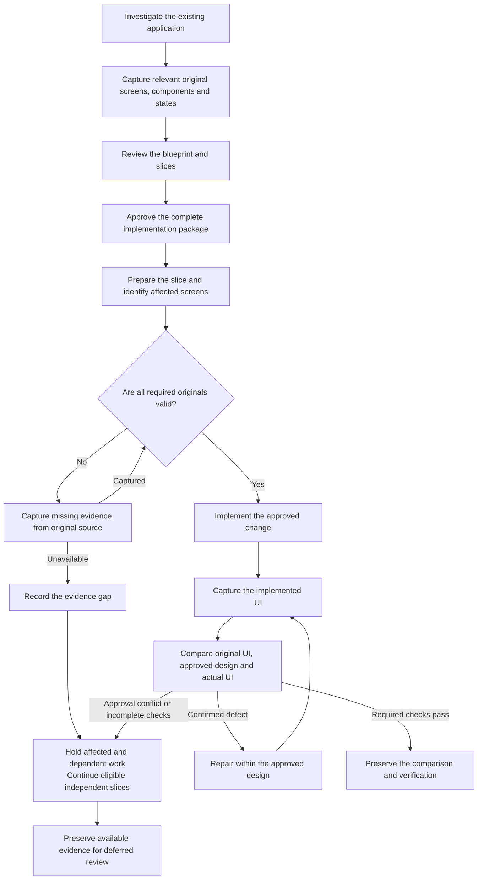
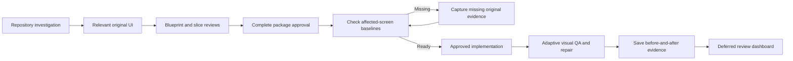

# Visual Baseline Capture and Design Reference Preservation

Use incremental visual baseline capture for existing UI and for shared components with consumers that already render. During discovery, preserve the existing application in selected rendered states. During implementation, inspect the same states against the approved design and actual code. Keep each reference independently addressable so sessions can resume from saved evidence.

## Baseline capture and verification flow



## Place in the workflow



## Capture the existing application during discovery

1. Select routes affected by the initiative. Use source, browser evidence, and the spread of reused components to choose likely regressions and intentional redesigns. Capture separate cases for behavior that changes with state, fixture, role, theme, or viewport. One case can cover several discovered features when they share the same rendered state. Backend-only features and genuinely new UI have no original rendered state.
2. Start the original application with reproducible test data. Use the [baseline template](../assets/project/visual-baseline.template.json). Assign a stable ID and associate it with discovered application-A feature IDs. Name relevant source files, including component, route, styles and fixture sources. Set the visible selector to the area that needs a close-up. Use separate cases for other relevant controls and interactions. Use `renderCase.setup` to reproduce the state, and record role, fixture and observations when the state depends on them. Set `color_scheme` when the application responds to the browser's theme preference. List the CSS custom properties relevant to the design in `design_tokens`; the capture also records computed typography, color and spacing.
3. Capture each case before modifying those sources. The receipt keeps the full-page image, component crop, component structure, observed interaction state, viewport, geometry, custom token values, browser version, source digests, Git revision when available, and confirmation of the served build. The browser uses the project source or the existing build-fingerprint protocol described in [Visual Integrity](visual-integrity.md). Include selectors, fixture setup and any extra measurements in the definition so a later session can reproduce the capture.
4. If the original cannot be rendered or faithfully recovered, use `--action gap` with the same definition and add `unavailable_reason` and `essential`. Mark evidence essential when the approved work cannot be compared reliably without it. The gap holds mapped slices and their transitive dependents while unrelated slices remain eligible. The gap record stays in history if original evidence is recovered. Retry using the same definition and original source. Restore known historical source safely before retrying. A screenshot from a changed implementation cannot serve as original evidence.
5. In the discovery audit, set `visual_baseline_ids` to the selected capture and gap IDs. Include the declared sources and the source files identified by the browser in the discovery sweeps (and source anchors in prototype mode). Keep the existing `discovery-capture` behavior evidence for each required role and state. New existing-UI initiatives require at least one capture or explicit gap in the audit. Add cases according to the initiative's scope. For greenfield or backend-only discovery use an empty list if including the field.

```sh
python3 scripts/project_state.py visual-baseline --project-root <app> --initiative-id <initiative> --action capture --input-file <case.json>
python3 scripts/project_state.py visual-baseline --project-root <app> --initiative-id <initiative> --action gap --input-file <gap.json>
```

## Expand coverage before changing shared UI

Follow [Cross-Screen Visual Regression Protection](cross-screen-regression.md). Register the change after approval and before touching source. A plan reuses compatible discovery evidence when the selected route, viewport, state, browser setup and relevant source hashes match. It captures only the missing cases. If a redesign changes the original selector or how the comparable state is reached, set `baseline_id` and `baseline_comparison_note` on the case to name the original and describe the mapping. Both cases keep their own setup and observed results. The route and viewport must match for that link. Use independent case records when routing or layout conditions differ.

Capture missing originals using `cross-screen --action capture` with phase `before`. If an explicitly linked original was a gap, recover and capture it under its original ID, then run `cross-screen --action reuse`. Run `cross-screen --action ready` with `{"change_id":"…"}` before editing. It checks that the original scoped source is still present and every required comparison has intact screenshots. Verification for new initiatives requires this recorded pre-edit check. If a required original is unavailable, save the reason in the case verification record, leave the change unverified and continue eligible independent work.

Each shared change preserves its own pre-edit original and its implementation attempts. A later change may need a fresh starting capture because the working UI has moved on since discovery. Keep the first discovery capture available as historical evidence.

## Verify and resume

- For a local slice case use `visual-integrity --action capture` as usual. A compatible original is linked automatically. If an updated control has a different selector or setup, or several originals match, provide `baseline_id` on the capture request and a `baseline_comparison_note` describing any changed conditions.
- Review the three references. Use the original to check existing behavior and the approved feature disposition, visual contract, acceptance checks, and protected decisions to determine intentional changes. Use browser captures of the implementation to verify the result. Record approved differences and confirmed defects using the [visual integrity classifications](visual-integrity.md#classify-against-approved-intent). Keep implementation captures and repairs as separate revisions.
- On handoff, use `resume --slice-id <slice> --format json` for baseline evidence, shared change records, and the approved package and guide. Use `visual-baseline --action list --slice-id <slice>` to find the original case, image paths, frozen design references, protected decisions, and linked implementation captures. Use `cross-screen --action list` for originals and later inspections attached to shared changes.
- Open **Visual Review Register** in the Living Blueprint and Slice Review viewer and select **Original UI baselines**. Search by slice, route or baseline ID. Expand the original, approved design, and implementation revisions. The register shows gaps, capture context, and side-by-side screenshots. Cross-screen cards retain annotated differences and repair history.
