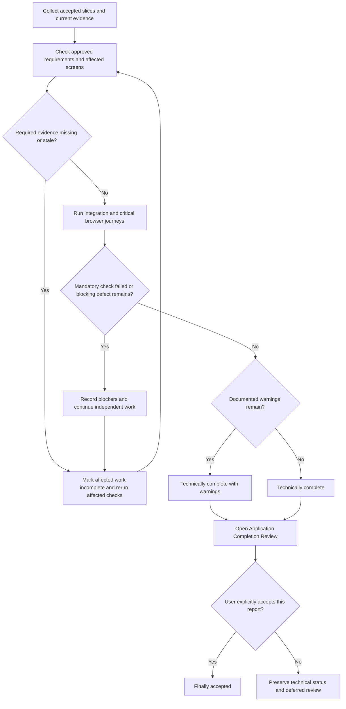

# Final Visual Quality Standards and Completion Criteria

Use this workflow to verify UI-changing slices, audit the completed application, and record the user's final acceptance. The [Visual Integrity Gate](visual-integrity.md) and [Cross-Screen Regression Protection](cross-screen-regression.md) record case evidence during implementation. The final audit reuses their receipts and checks the integrated application.

## Verify each UI-changing slice

| Verification | Evidence |
| --- | --- |
| Visual quality | Real browser full-screen and component screenshots of relevant states. |
| Layout | Measured alignment, positioning, overflow and spacing against the approved criteria and neighboring controls. |
| Design consistency | Observed results for approved requirements and protected decisions. Include original and approved references where applicable. |
| Interactions | Exercise the actual control and compare observed outcomes with the approved behavior. |
| Responsive behavior | Test approved viewports and add widths relevant to the change, such as a breakpoint or a constrained container. |
| Accessibility | Exercise relevant keyboard paths and verify focus movement or return. Check names, roles, expanded state and disabled state where applicable. |
| Shared UI | Record passing or unavailable results for every affected screen selected by the targeted cross-screen plan. |
| Repairs | Preserve the defect and corrected captures, annotated regions, repair explanation and fresh passing checks. |

Record accessibility on each selected coverage row using `accessibility: {"result":"pass","note":"…"}`. A pass requires recorded keyboard input and a positive focus assertion for a named, semantic control within the captured component. Every captured assertion must pass. Use the `accessibility` browser probe to assert that the keyboard target has the expected name, role, and applicable states in Chromium’s accessibility tree. Its `expected` object can include `name`, `role`, `expanded`, `disabled`, `selected`, `checked`, and `pressed`. Include relevant semantics and visible outcomes in approved case assertions so rechecks exercise them. Where an exact approved case fixes its setup, add a supplementary keyboard case based on it with the same route, viewport, theme and role, and reference that case in `accessibility.evidence_case_id`. For a cross-screen plan, capture the keyboard exercise in that exact case or use the supplemental keyboard capture described in the [cross-screen workflow](cross-screen-regression.md). Use `not_applicable` with a specific rationale when browser evidence shows a passive component and keyboard or focus checks do not apply. Use `fail` for a failed required check and `not_checked` with a reason for missing evidence. New initiatives enforce this at the visual gate. Earlier evidence remains readable and needs current applicable accessibility evidence for technical completion.

| Slice verification | Meaning | Implementation |
| --- | --- | --- |
| Verified | All mandatory checks passed. Any repairs were rechecked. | Release dependent work through normal reconciliation. |
| Verified with warnings | All mandatory checks passed. Documented nonblocking concerns remain. | Release dependent work through normal reconciliation. |
| Needs correction | A required visual, interaction, accessibility, functional or blueprint check failed. | Correct the affected slice. Independent work can continue. |
| Not verified | Required evidence is missing, stale, or incomplete. | Obtain fresh evidence. Independent work can continue. |

Base severity on user impact and the accepted contract.

- **Critical** covers unusable essential controls, essential accessibility failures, broken navigation and data-loss risks.
- **Major** covers failures such as essential clipping, overlapping controls, incorrect hierarchy or an explicit layout requirement violation. Critical and major findings block affected work.
- **Minor** covers measurable imperfections outside mandatory criteria. Prefer a straightforward repair. Use `status: deferred`, `severity: minor`, `classification: confirmed_defect`, and `nonblocking_reason` only after the required checks pass. Attach annotated evidence. A blocking finding requires a verified repair.
- **Design concern** covers subjective choices or ambiguous styling. Use `classification: design_concern`, `severity: design_concern`, and `status: noted`. Preserve the approved decision. An explicitly approved difference uses `severity: info` and is recorded as an approved difference.

For a cross-screen warning supply `normalized_rect` on the affected after close-up. A cross-screen repair compares the originally defective close-up with the rechecked result. An approved prototype capture waiver cannot substitute for an essential original or a required browser or functional check. Keep all concerns and verified fixes in the Visual Review Register for deferred review.

## Run the final application audit



1. Reconcile every active slice against the locked package. Confirm that the required features, behavior, and blueprint checks are covered. Resolve blockers or collect missing data in the affected areas.
2. Prepare an audit input inside the initiative using the [audit template](../assets/project/visual-quality-audit.template.json). Include at least one application integration check and browser journey checks covering each UI slice. Select critical flows that cross feature, role, state or screen boundaries. Group related slices in a single journey when that exercises the real integration. Keep established audit check IDs, expected outcomes and their active slice scope on retries and subsequent audits. To display named roadmap workstreams, add an optional `workstreams` array with a `title` and `slice_ids` for each area. The dashboard always includes individual slices and approved features.
3. List the actual test and helper source paths for each check. Commands run as argument arrays from the application root. Each command emits a JSON object with `check_id`, `expected`, `actual` and `result: "pass"`. Emit diagnostics on standard error. Exercise the actual application or integration and report its observations. Use a reproducible, nonproduction fixture. Keep credentials and sensitive fixture data out of audit output.
4. Run the audit. It validates slice evidence, baseline and cross-screen holds, approved requirement coverage, and the workspace before and after executing the commands. Repeating the same successful audit with unchanged inputs and fingerprints reuses its report. After a change, reuse still-current slice and cross-screen receipts, refresh stale or affected ones, and rerun the integrated checks for the current application.
5. Present the current report and its audit ID and SHA-256. The [Application Completion Review](final-review.md) dashboard is available automatically. It shows slice outcomes, check results, repairs and warnings, with links to the Visual Review Register.

```sh
python3 scripts/project_state.py visual-quality --project-root <app> --initiative-id <id> --action audit --input-file <audit.json>
python3 scripts/project_state.py visual-quality --project-root <app> --initiative-id <id> --action status
python3 scripts/project_state.py review-viewer --project-root <app> --initiative-id <id>
```

## Record final acceptance

The project status is **In implementation**, **Blocked**, **Technically complete**, **Technically complete — with warnings**, or **Finally accepted**. Technical completion requires all mandatory checks and allows nonblocking warnings. The user can inspect and request corrections with or without accepting the current report.

When the user explicitly accepts the completed application against a specific current report, follow the [exact audit acceptance instruction](conversation-controller.md#record-final-acceptance) for controller-enabled initiatives. Save `approval_id`, `audit_id`, `audit_sha256` (from `status`), `approved_by_user: true`, and the actual `user_response` in an input file and run:

```sh
python3 scripts/project_state.py visual-quality --project-root <app> --initiative-id <id> --action accept --input-file <acceptance.json>
```

The command checks the exact report and live fingerprints. The viewer is read-only. Blueprint approval, implementation authorization, and coordinator slice acceptance are separate records. Deployment and merging remain subject to their own authorization.

For later corrections and optional walkthroughs, follow [Application Completion Review](final-review.md).
